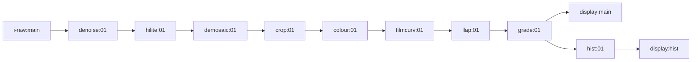

# Default raw pipeline

When a raw file is opened for the first time it gets a copy of
`bin/default-darkroom.i-raw`. This page reads that file top to bottom.

## The graph

Also present in the file but not wired to anything: `zones:01`, `lens:01`, `pick:01`.
They are listed so the GUI can offer them without the user adding a module, and the
scheduler skips them because no sink depends on them.

## Module by module

| module | connectors | what it does | nodes |
|--------|-----------|--------------|------:|
| `i-raw:main` | `output:source:*:ui16` | decodes the raw file on the CPU (rawspeed or rawler), uploads 16-bit mosaic data; fills black, white, white balance, matrix, noise model into the [image metadata](../concepts/image-params-metadata.md) | 1 source |
| `denoise:01` | `input:read:*:*`, `output:write:&input:*` | wavelet denoise with the camera's noise profile; also subtracts the black point and removes the black borders | 6 |
| `hilite:01` | same shape | reconstructs clipped highlights on the mosaic by local inpainting | 4 |
| `demosaic:01` | `input:read:rggb:*`, `output:write:rgba:f16` | turns the mosaic into full colour; method combo: gaussian splats, RCD, half size. Changing the method rebuilds the graph (`check_params` returns `s_graph_run_all`) | 2 to 6 of 11 possible |
| `crop:01` | `input:read:*:*`, `output:write:&input:f16` | applies EXIF orientation, crop, rotation, perspective | 1 |
| `colour:01` | `input:read:rgba:*`, `output:write:rgba:*`, plus optional `clut`, `picked`, `abney`, `spectra` inputs | white balance, camera matrix or spectral input transform, gamut handling, exposure | 3 |
| `filmcurv:01` | `input`, `output`, `dspy:write:rgba:f16` | film-like tone curve; `dspy` draws the curve for the GUI | 3 |
| `llap:01` | `input:read:rgba:f16`, `output:write:rgba:f16` | local contrast, shadows and highlights via local Laplacian pyramid; defaults `sigma 0.12`, `shadows 1`, `hilights 1`, `clarity 0.2` | about 24 |
| `grade:01` | `input:read:*:*`, `output:write:*:*` | ASC CDL slope, offset, power, saturation | 1 |
| `display:main` | `input:sink:rgba:*` | the main image on screen | 0 (sink) |
| `hist:01` | `input:read:rgba:f16`, `output:write:rgba:*` | waveform histogram image | 2 |
| `display:hist` | `input:sink:rgba:*` | the histogram panel | 0 (sink) |

Node counts are `dt_node_add` call sites in each `main.c`, or 1 for modules without
`main.c`. The whole default graph has roughly 50 nodes at full size.

## Formats along the chain

`i-raw` outputs `ui16` with channel layout set at run time from the file (`rggb` for
Bayer, `rgba` for already demosaiced input). `denoise`, `hilite` and `crop` use `&input`
so they keep whatever they are given. `demosaic` requires `rggb` in and produces
`rgba:f16`. From there on everything is `rgba:f16` until the display sink, whose `*`
format resolves to the swap chain format (`dspy`).

## The thumbnail version

`bin/default.i-raw` is the same chain up to `filmcurv`, then `colenc:main` (encode to
rec2020 primaries with an sRGB curve: `prim:2`, `trc:2`) and `o-bc1:main`
(`input:sink:rgba:ui8`). No `llap`, `grade`, `hist` or display. It is small so that two
thumbnail threads can grind through a folder quickly. See
[database and thumbnails](../components/database-and-thumbnails.md).

## Other input types

There is a pair of defaults for each input module that has one: `i-bc1`, `i-exr`,
`i-jpg`, `i-lut`, `i-mcraw`, `i-mlv`, `i-pfm`, `i-raw`, `i-vid` (`bin/default*.i-*`).
The input module is chosen from the file extension in `src/pipe/graph-defaults.h`.

## Sources

- `bin/default-darkroom.i-raw`, `bin/default.i-raw`
- `src/pipe/modules/{i-raw,denoise,hilite,demosaic,crop,colour,filmcurv,llap,grade,hist,display,colenc,o-bc1}/connectors`
- `src/pipe/modules/readme.md` ("default pipeline")
- `grep -c dt_node_add src/pipe/modules/*/main.c` on 2026-11-09

## Related

- [Recipe file format](../concepts/cfg-recipe-format.md)
- [Worked example: llap](llap-worked-example.md)
- [Module catalog](module-catalog.md)
