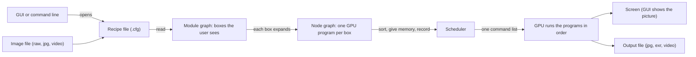

# Architecture in one picture

vkdt does all image work on the GPU. The heart of the app is a graph of boxes connected by
arrows. Arrows only point forward, never in a circle, so the app can sort the boxes into a
running order and hand that order to the GPU.

Read it left to right:

1. The user opens an image. Next to it lives a small text file, the **recipe** (`.cfg`). It
   lists boxes, arrows and settings. See [recipe format](../concepts/cfg-recipe-format.md).
2. The app reads the recipe into the **module graph**. A [module](../concepts/module.md) is a
   box with a name, such as `denoise` or `crop`.
3. Each module turns itself into one or more **nodes**. A [node](../concepts/node.md) is a
   single GPU program (a compute shader).
4. The **scheduler** sorts all nodes so every box runs after the boxes it needs, gives each
   result a piece of GPU memory, and writes one list of GPU commands. See
   [scheduler run passes](../components/scheduler-run-passes.md).
5. The **GPU** runs the list. The result goes to the screen, or to a file when exporting.

## The same picture as layers

| layer | lives in | the thing | size limit |
|-------|----------|-----------|-----------|
| text | `image.cfg` beside the image | lines: `module:`, `connect:`, `param:` | none |
| module graph | `dt_graph_t.module[]` | `dt_module_t`, what the graph editor shows | 100 per graph |
| node graph | `dt_graph_t.node[]` | `dt_node_t`, one `.comp` kernel each | 2000 per graph |
| schedule | `src/pipe/graph.c` | topological order, memory plan, command buffer | one command buffer per run |
| GPU | Vulkan device | dispatches, barriers, timeline semaphore | |

The limits are fixed arrays: `modid[100]` and `nodeid[2000]` in `src/pipe/graph.c:795,811`
and a 1000-deep traversal stack in `src/pipe/graph-traverse.inc`.

## Front-ends share the graph

- The **GUI** (`vkdt`) edits parameters and wires on the module graph and shows the display
  sink as a texture that never leaves video memory.
- The **CLI** (`vkdt-cli`) loads the same recipe and replaces `display` sinks with `o-jpg`,
  `o-pfm` or other output modules. See [CLI and export](../components/cli-and-export.md).
- **Thumbnails** run a smaller default recipe (`bin/default.i-*`) through the same code into
  a compressed cache. See [database and thumbnails](../components/database-and-thumbnails.md).

## Five facts to remember

1. Everything is a graph, and the graph is saved as a small text file.
2. The scheduler starts at the sinks (screen, output file) and walks backwards. Boxes that do
   not lead to a sink are skipped.
3. Because the whole graph is known before anything runs, memory for in-between results is
   reused. That is why big images fit on the GPU. See [memory aliasing](../concepts/memory-aliasing.md).
4. Moving a slider usually only sends new numbers to the GPU and re-runs the same command
   list. Changing the shape of the graph rebuilds the nodes. See [run flags](../concepts/run-flags.md).
5. The same recipe works in the GUI, in the command line exporter, and for thumbnails. Only
   the sink box changes.

## Sources

- `src/pipe/graph.h` (the `dt_graph_t` struct)
- `src/pipe/graph.c:770-1001` (`dt_graph_run`), `:795, 811` (fixed arrays)
- `src/pipe/graph-io.c:232-254` (recipe line dispatch)
- `src/gui/main.c`, `src/cli/main.c` (the two front-ends)

## Related

- [Data flow of an edit](data-flow-of-an-edit.md)
- [Processing graph (DAG)](../concepts/processing-graph-dag.md)
- [Scheduler: the run passes](../components/scheduler-run-passes.md)
